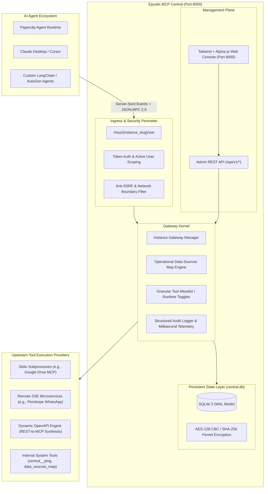

# Epyatis MCP Central

[](https://www.python.org/)
[](https://modelcontextprotocol.io/)
[](LICENSE)
[](#system-architecture)
[](#security-and-hardening-architecture)

**Enterprise-Grade Model Context Protocol (MCP) Gateway, Reverse Proxy, and Multi-Tenant Tool Aggregation Hub.**

Epyatis MCP Central provides a robust orchestration layer that bridges autonomous AI agent platforms (such as **Paperclip**, **Claude Desktop**, **Cursor**, **Codex**, and custom LLM agents) with heterogeneous enterprise data sources and execution environments.

Instead of configuring dozens of individual MCP servers on each agent workstation or container, MCP Central aggregates multiple upstream servers (local stdio subprocesses, remote SSE microservices, and dynamic OpenAPI/REST specifications) into logical, scoped, and token-authenticated endpoints.

---

## Table of Contents

- [Key Problem Solved](#key-problem-solved)
- [System Architecture](#system-architecture)
- [Core Capabilities](#core-capabilities)
- [Directory Structure](#directory-structure)
- [Getting Started](#getting-started)
  - [Prerequisites](#prerequisites)
  - [Installation & Local Setup](#installation--local-setup)
  - [Environment Configuration](#environment-configuration)
  - [Running the Gateway](#running-the-gateway)
- [Connecting AI Agents](#connecting-ai-agents)
  - [Paperclip Connection](#paperclip-connection)
  - [Claude Desktop / Cursor Configuration](#claude-desktop--cursor-configuration)
- [Upstream Integrations Guide](#upstream-integrations-guide)
  - [Google Drive Workspace](#1-google-drive-workspace)
  - [Periskope WhatsApp](#2-periskope-whatsapp)
  - [Dynamic OpenAPI / Swagger Translation](#3-dynamic-openapi--swagger-translation)
  - [Secure Local Filesystem](#4-secure-local-filesystem)
- [Multi-User Governance & RBAC Scoping](#multi-user-governance--rbac-scoping)
- [Security & Hardening Architecture](#security--hardening-architecture)
- [API Reference Summary](#api-reference-summary)
- [Testing & Quality Assurance](#testing--quality-assurance)
- [Contributing](#contributing)
- [License](#license)

---

## Key Problem Solved

Modern AI agent deployments face severe operational hurdles:
1. **Tool Sprawl & Context Overload:** Exposing hundreds of raw tools directly to LLMs degrades reasoning performance and balloons token overhead.
2. **Scattered Authentication & Secret Leakage:** Managing OAuth credentials, database passwords, and API keys across disparate agent configurations introduces critical security vulnerabilities.
3. **Lack of Governance & Observability:** Enterprises lack centralized audit trails detailing which agent invoked which tool, with what arguments, and what the execution latency was.
4. **Heterogeneous Protocols:** AI agents must interface with stdio subprocesses, remote HTTP/SSE streaming servers, and legacy REST APIs simultaneously.

**Epyatis MCP Central solves these challenges** by establishing a single point of control, telemetry, sandboxing, and policy enforcement.

---

## System Architecture



---

## Core Capabilities

| Capability | Description |
| :--- | :--- |
| **Namespace Isolation & Dynamic Prefixing** | Discovers tools across multiple upstreams and prefixes them (e.g., `gdrive__search_files`, `periskope__send_message`) to eliminate naming collisions. |
| **Granular Tool Allowlist & Runtime Toggles** | Selectively enable or disable individual tools per instance without restarting the gateway or disconnecting agents. Disabled tools are excluded from `tools/list` and blocked on execution. |
| **Dynamic OpenAPI / Swagger Translation** | Ingests OpenAPI v3 specs (JSON, YAML, or secure remote URLs) and synthesizes schema-validated MCP tools on the fly for any REST API. |
| **Connection Templates & 1-Click Instantiation** | Pre-packaged connection recipes (Google Drive, WhatsApp, PostgreSQL, Filesystem, OpenAPI) with guided setup wizards. Save existing connections as reusable templates. |
| **Data-Source Kits & Architectural Guidance** | Manage operational data source blueprints defining where corporate knowledge lives and inject guidance automatically into agent contexts via `central__get_data_sources_map`. |
| **Multi-User RBAC & Scoping Governance** | Scoped assets (`private`, `shared`, `public`). Strict rule: only a verified Master Admin (`epy_root`) can elevate entities to `public` visibility. |
| **Auditing & Telemetry Engine** | Intercepts all tool execution requests, capturing timestamp, client instance, arguments, execution duration (ms), and output status. |
| **Zero-Trust Security Sandbox** | Built-in anti-SSRF protections against private IP range abuse, path traversal containment on filesystem tools, and Fernet AES-128-CBC encryption for stored secrets. |

---

## Directory Structure

```
.
├── config/
│   └── bootstrap_instances.yaml    # Declarative startup configuration for instances & connections
├── scripts/
│   └── get_gdrive_refresh_token.py # Standalone OAuth2 helper for full Google Drive scopes
├── src/
│   └── central/
│       ├── api/
│       │   ├── __init__.py
│       │   └── routes.py           # REST endpoints for UI, connections, templates, and kits
│       ├── db/
│       │   ├── __init__.py
│       │   ├── entities.py         # SQLAlchemy 2.0 models (User, Connection, Instance, AuditLog)
│       │   ├── repository.py       # Query abstractions and visibility-filtered CRUD
│       │   ├── seeder.py           # Database bootstrap migrations and seed data
│       │   └── session.py          # SQLite engine configuration (WAL mode & thread isolation)
│       ├── gateway/
│       │   ├── __init__.py
│       │   ├── instance_gateway.py # Low-level JSON-RPC routing & tool execution dispatcher
│       │   └── manager.py          # Lifecycle manager for active MCP instances
│       ├── security/
│       │   ├── __init__.py
│       │   ├── auth.py             # RBAC authentication and visibility validation
│       │   ├── crypto.py           # Fernet encryption / decryption helpers
│       │   ├── ssrf.py             # Anti-SSRF URL and network address validation
│       │   └── validation.py       # Shell command injection and path containment validators
│       ├── templates_catalog/
│       │   ├── __init__.py
│       │   └── registry.py         # Built-in template definitions
│       ├── ui/
│       │   ├── __init__.py
│       │   └── dashboard.py        # Single-page Alpine.js + Tailwind administrative interface
│       ├── upstreams/
│       │   ├── __init__.py
│       │   ├── base.py             # Upstream driver interface
│       │   ├── internal.py         # Gateway-level built-in MCP tools
│       │   ├── openapi_upstream.py # Dynamic REST-to-MCP translation driver
│       │   ├── remote_sse_upstream.py # Remote SSE MCP client driver
│       │   └── stdio_upstream.py   # Subprocess stdio MCP client driver
│       ├── config.py               # Pydantic Settings application configuration
│       ├── main.py                 # CLI entry point
│       ├── models.py               # API request and response validation schemas
│       └── server.py               # FastAPI application setup and middleware
├── tests/
│   ├── test_bootstrap.py
│   ├── test_phase1.py
│   ├── test_phase2.py
│   ├── test_phase3_multiuser_visibility.py
│   ├── test_qa_e2e_buttons.py
│   └── test_security_hardening.py
├── .env.example
├── .gitignore
├── CONTRIBUTING.md
├── pyproject.toml
└── requirements.txt
```

---

## Getting Started

### Prerequisites

- **Python 3.11+** installed.
- **Node.js 18+** (recommended for `npx`-based Stdio connectors).
- **Git**.

### Installation & Local Setup

1. **Clone the repository:**
   ```bash
   git clone https://github.com/Scheuer12/epyatis-mcp-central.git
   cd epyatis-mcp-central
   ```

2. **Create and activate a virtual environment:**
   ```bash
   # Linux / macOS
   python3 -m venv .venv
   source .venv/bin/activate

   # Windows PowerShell
   python -m venv .venv
   .\.venv\Scripts\Activate.ps1
   ```

3. **Install dependencies:**
   ```bash
   pip install -e .
   ```

### Environment Configuration

Copy the example environment configuration:
```bash
cp .env.example .env
```

Edit `.env` to configure your master keys and upstream credentials:
```ini
# Core Gateway Settings
CENTRAL_HOST=127.0.0.1
CENTRAL_PORT=8000
CENTRAL_SECRET_KEY=generate-a-32-byte-base64-key-here
CENTRAL_ADMIN_KEY=your-secure-admin-api-key

# Upstream Integrations (Optional)
PERISKOPE_API_KEY=your_periskope_api_token
PERISKOPE_MCP_URL=https://api.periskope.app/mcp
```

> **Security Note:** You can generate a strong encryption key using Python:
> ```bash
> python -c "from cryptography.fernet import Fernet; print(Fernet.generate_key().decode())"
> ```

### Running the Gateway

Start the production-ready ASGI server:
```bash
python -m central.main
```

Or run with automatic reload during development:
```bash
uvicorn central.server:app --reload --host 127.0.0.1 --port 8000
```

Once running, access the web dashboard:
👉 **`http://127.0.0.1:8000/`**

---

## Connecting AI Agents

### Paperclip Connection

In the **Paperclip** agent administration console:
1. Navigate to **Connectors** -> **Add New Connector**.
2. **Connector Type:** `MCP Server (SSE)`.
3. **Endpoint URL:**
   ```
   http://127.0.0.1:8000/mcp/horst-suite/sse?token=epy_dev_token_123
   ```
4. Save the connector. Paperclip will immediately discover all allowed tools aggregated by that instance.

### Claude Desktop / Cursor Configuration

Add the SSE endpoint to your `claude_desktop_config.json`:

```json
{
  "mcpServers": {
    "epyatis-central": {
      "url": "http://127.0.0.1:8000/mcp/horst-suite/sse?token=epy_dev_token_123"
    }
  }
}
```

---

## Upstream Integrations Guide

### 1. Google Drive Workspace

MCP Central integrates with Google Drive using the `@us-all/google-drive-mcp` or `@modelcontextprotocol/server-gdrive` servers.

To authorize full read and write access:
1. Obtain OAuth 2.0 Client credentials from the [Google Cloud Console](https://console.cloud.google.com/) (Application type: Desktop App).
2. Save the downloaded JSON as `gdrive-oauth.keys.json` in the project root.
3. Run the automated OAuth helper:
   ```bash
   python scripts/get_gdrive_refresh_token.py
   ```
4. Complete the browser authentication prompt. The script automatically updates `.env` with the necessary tokens and full read/write scopes.

### 2. Periskope WhatsApp

Configure your Periskope API token in `.env`. When active, Periskope tools will be exposed under the `periskope__` namespace (e.g., `periskope__list_chats`, `periskope__send_message`).

### 3. Dynamic OpenAPI / Swagger Translation

Connect any REST API with an OpenAPI 3.0+ specification:
1. Open the Central dashboard and navigate to **Connection Templates** -> **REST API (OpenAPI / Swagger)**.
2. Provide the OpenAPI specification URL (or paste raw JSON/YAML) and your authentication header.
3. MCP Central validates the schema and synthesizes distinct MCP tools for each endpoint and HTTP method with full type validation.

### 4. Secure Local Filesystem

Create sandboxed filesystem connections with strict directory containment:
1. Select the **Filesystem Local Seguro** template in the dashboard.
2. Specify the `allowed_dir` path. MCP Central enforces path boundary checks to prevent directory traversal attacks outside the designated root.

---

## Multi-User Governance & RBAC Scoping

Epyatis MCP Central provides comprehensive user isolation and session management:

- **User Roles:**
  - `epy_root`: Master Administrator. Holds elevated privileges to configure global settings, inspect audit logs across all instances, and publish shared assets to `public` visibility.
  - Standard User: Can create private connections, custom templates, and instances.
- **Visibility Levels:**
  - `private`: Accessible only to the creator user.
  - `shared`: Accessible to all authenticated users in the organization.
  - `public`: Accessible publicly across instances. **Strict Enforcement:** Only a Master Admin (`epy_root`) can set any asset to `public`. Any attempt by standard users to publish an asset as `public` returns `403 Forbidden`.

---

## Security & Hardening Architecture

1. **Anti-SSRF Protection:** External URL targets are verified against non-routable, link-local, loopback, and private IPv4/IPv6 ranges before any HTTP client initiates requests.
2. **Encrypted Persistence:** All sensitive credentials stored in SQLite are encrypted at rest using AES-128-CBC with SHA-256 HMAC authentication via the Fernet standard.
3. **Execution Sandboxing:** Subprocess commands for stdio upstreams pass through command-injection validation routines that disallow shell metacharacters and unvalidated piping.
4. **Token Isolation:** Each instance issues independent bearer tokens. Compromising one agent token does not provide access to other configured instances.

---

## API Reference Summary

| Method | Endpoint | Description | Auth Required |
| :--- | :--- | :--- | :--- |
| `POST` | `/api/v1/auth/login` | Authenticate with username or admin key | None |
| `POST` | `/api/v1/auth/switch-user` | Switch active session to another user profile | None (Local Dev) |
| `GET` | `/api/v1/auth/me` | Retrieve profile and role of active session user | Session / Admin |
| `GET` | `/api/v1/overview` | Retrieve system telemetry, tool counts, and success rate | Admin Key |
| `GET` | `/api/v1/connections` | List connections visible to the authenticated user | Session / Admin |
| `POST` | `/api/v1/connections` | Register a new upstream connection with visibility scoping | Session / Admin |
| `POST` | `/api/v1/connections/{id}/discover` | Probe upstream connection and refresh tool signatures | Session / Admin |
| `GET` | `/api/v1/connection-templates` | List reusable connection models/presets | Session / Admin |
| `POST` | `/api/v1/connection-templates` | Create a new connection template preset | Session / Admin |
| `POST` | `/api/v1/connections/from-template` | Instantiate a functional connection from a template in 1 click | Session / Admin |
| `GET` | `/api/v1/instances` | List configured MCP instances visible to user | Session / Admin |
| `POST` | `/api/v1/instances` | Create a new isolated MCP instance | Session / Admin |
| `GET` | `/api/v1/instances/{slug}/tools` | List aggregated tools and active toggle states for an instance | Session / Admin |
| `POST` | `/api/v1/instances/{slug}/tools/{tool_id}/toggle` | Enable or disable tool execution on an instance | Session / Admin |
| `GET` | `/api/v1/data-source-kits` | List shared data-source kits | Session / Admin |
| `POST` | `/api/v1/data-source-kits` | Save a new operational knowledge kit | Session / Admin |
| `POST` | `/api/v1/data-source-kits/{id}/apply` | Apply a data-source kit onto an instance | Session / Admin |
| `GET` | `/api/v1/audit-logs` | Retrieve chronological tool execution logs and latencies | Admin Key |
| `GET` | `/mcp/{slug}/sse` | MCP Server-Sent Events entrypoint for AI agent clients | Bearer Token |

---

## Testing & Quality Assurance

The codebase includes an extensive suite of automated tests covering unit logic, integration flows, security boundaries, and regression verification:

```bash
# Run all tests with verbose output
pytest -v

# Run security hardening tests specifically
pytest -v tests/test_security_hardening.py

# Run multi-user visibility and RBAC governance tests
pytest -v tests/test_phase3_multiuser_visibility.py
```

---

## Contributing

We welcome community contributions, bug reports, and enhancements. Please review [CONTRIBUTING.md](CONTRIBUTING.md) for coding conventions, security guidelines, and the pull request submission process.

---

## License

This project is licensed under the [MIT License](LICENSE).
